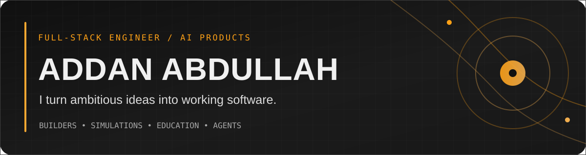
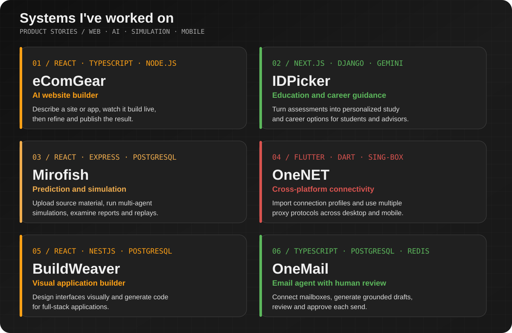
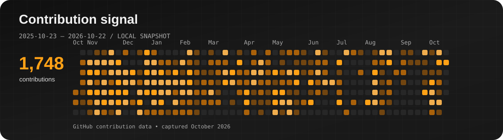
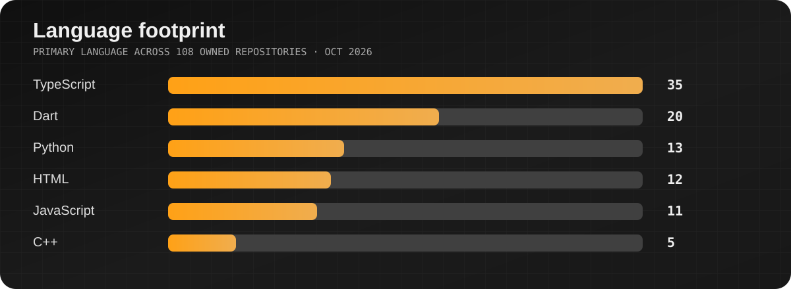

## Hello, I'm Addan

I build tools that help people create websites, choose education paths, explore possible outcomes, handle email, and connect across devices. My work spans React and TypeScript interfaces, Python services, Flutter apps, background workers, databases, and deployment.

### Products and systems

**[eComGear](https://www.ecomgear.dev/) // AI website and app builder.** Describe what you want in plain language, inspect the generated site in a live preview, request changes, and publish it. Built with React/Vite, an Express and TypeScript agent runtime, Supabase, and separate preview and hosting services.

**[IDPicker](https://idpicker.com/) // education and career guidance.** Students complete assessments and explore personalized study and career options; advisors and administrators have their own workflows. Built with Next.js and TypeScript interfaces, a Django REST backend, PostgreSQL, and Gemini-powered recommendations.

**[Mirofish](https://mirofish.life/) // prediction through multi-agent simulation.** Upload source material, run simulations across possible scenarios, then inspect reports and replay what happened. The app uses React and TypeScript, an Express API, PostgreSQL-backed background jobs, and object storage for artifacts.

**OneNET // cross-platform connectivity app.** Import and manage connection profiles, choose endpoints, and connect through multiple proxy protocols from one interface. Built with Flutter/Dart and sing-box, with code for Android, iOS, Windows, macOS, and Linux.

**[BuildWeaver](https://github.com/AA-Siddiqui/BuildWeaver) // visual app builder.** Design interfaces in a React editor and generate code for full-stack applications. Its NestJS API, PostgreSQL and Redis services, and shared code-generation packages support the editing and build workflow.

**OneMail // email agent with human review.** Connect mailboxes, retrieve relevant context, generate reply drafts, and approve a message before it is sent. Built with TypeScript, IMAP/SMTP, PostgreSQL with pgvector, and Redis for durable workflow processing.

### More projects

| Project | Purpose and technology |
| :-- | :-- |
| [**University Management System**](https://github.com/AA-Siddiqui/Mobile-Application-Development-Project-S25) | Flutter app for students, teachers, and administrators to manage academic workflows. |
| [**Employee Management App**](https://github.com/AA-Siddiqui/Employee-Management-App-Semester-Project) | Flutter and Hive app to save and edit employee records, with date validation and a walkthrough video. |
| [**SpellChecker**](https://github.com/AA-Siddiqui/SpellChecker) | C++ text editor with trie-based spelling support and rope-based text handling. |
| [**Library Management System**](https://github.com/AA-Siddiqui/LibraryManagementSystem) | Java Swing desktop app for managing library users and books with Microsoft SQL Server. |

### Activity, in pictures

**Problem solving on LeetCode**

### Stack

`TypeScript` · `React` · `Next.js` · `Node.js` · `NestJS` · `Python` · `Django` · `Flutter` · `PostgreSQL` · `Docker`

The contribution and language charts are snapshots from October 2026. The LeetCode card updates through a third-party image service.

